<div align="center">



[](https://personadle.net)
[](https://github.com/CodeByHaamza/personadle/releases)
[](https://github.com/CodeByHaamza/personadle/actions/workflows/ci.yml)
[](tests/README.md)
[](https://discord.gg/wpMdGGDp3y)
[](LICENSE.txt)

### Guess today's Persona character.

**Six modes**, a **new target every day** at midnight (Paris time), from *Persona 1* to *Persona 5X*.<br>
*Classic · Emoji · Silhouette · All-Out Attack · Personae · Music* — each with its **Expert** twin.


<br>

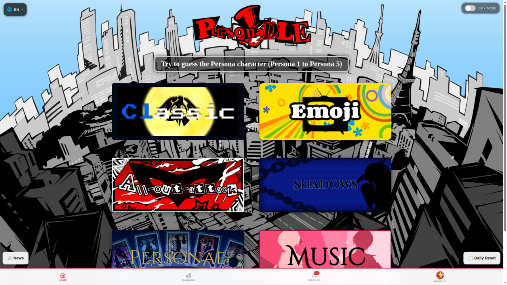

<br>

[**▶ Play**](#-play) &nbsp;·&nbsp;
[**🎯 Modes**](#-six-modes-twelve-ways-to-play) &nbsp;·&nbsp;
[**✨ Features**](#-features) &nbsp;·&nbsp;
[**🆕 What's new**](#-whats-new) &nbsp;·&nbsp;
[**🛠️ Under the hood**](#️-under-the-hood) &nbsp;·&nbsp;
[**🧑‍💻 Run it locally**](#-run-it-locally) &nbsp;·&nbsp;
[**💬 Community**](#-community)

</div>


## 🎮 Play

Every day at midnight (Paris time), each mode draws a new target. Guess it with the clues you're given,
compare with your friends, keep your streak alive.

1. Open **[personadle.net](https://personadle.net)** — no install, no account required.
2. Pick a mode. Type a name; the autocomplete shows portraits.
3. Every guess reveals something. Find the answer, or **give up** to see it.
4. **Replay** as many times as you like — every game counts toward your stats; the main leaderboard counts each mode's first game of the day.
5. Create a free account to sync across devices, add friends, climb the leaderboard and unlock badges.

> 🇫🇷 🇪🇸 🇩🇪 🇮🇹 🇵🇹 The whole game is available in six languages, auto-detected from your browser.


## 🎯 Six modes, twelve ways to play


<table>
  <tr>
    <td align="center" width="33%">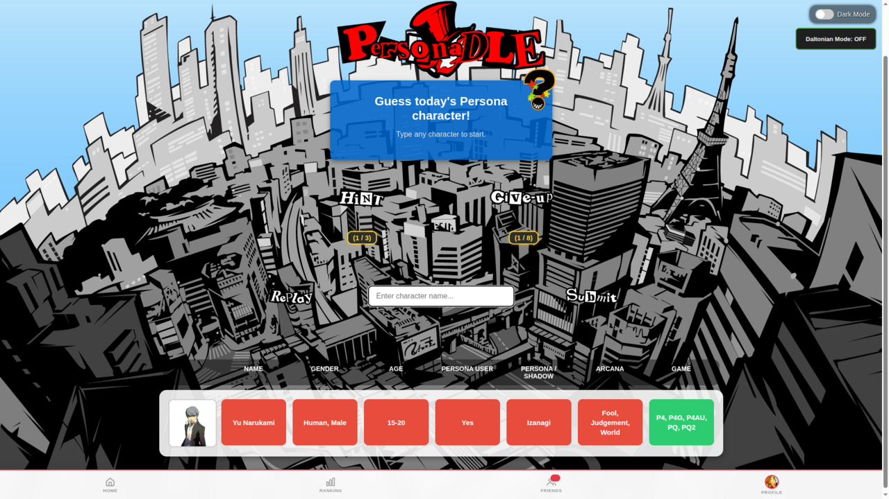<br><b>🔍 Classic</b><br><sub>Compare traits — Arcana, gender, age, game, Persona — with colour-coded feedback.</sub></td>
    <td align="center" width="33%">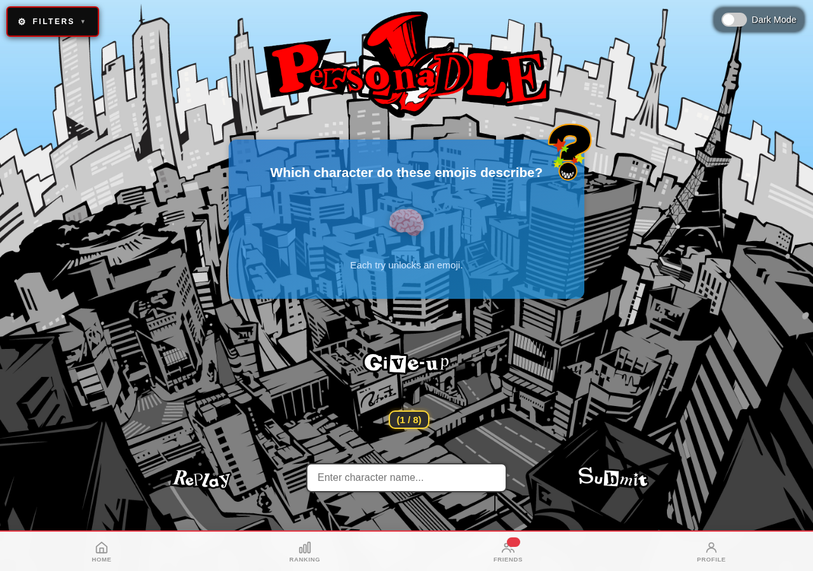<br><b>😀 Emoji</b><br><sub>Four emojis describe a character. One new emoji every wrong guess.</sub></td>
    <td align="center" width="33%">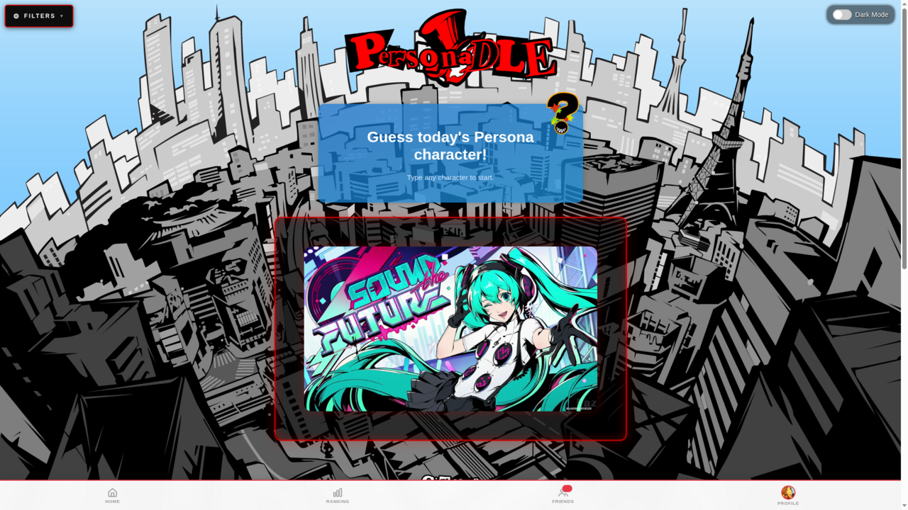<br><b>⚔️ All-Out Attack</b><br><sub>Recognise the finisher animation, from a blurred frame to the full sequence.</sub></td>
  </tr>
  <tr>
    <td align="center">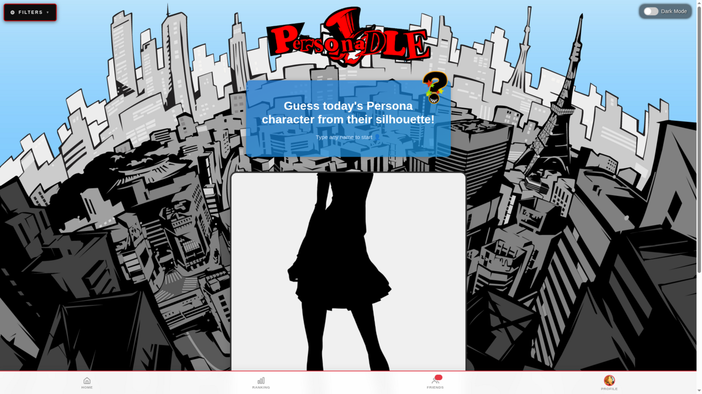<br><b>🖤 Silhouette</b><br><sub>A black shape that sharpens with each attempt. Right-click can't cheat it.</sub></td>
    <td align="center">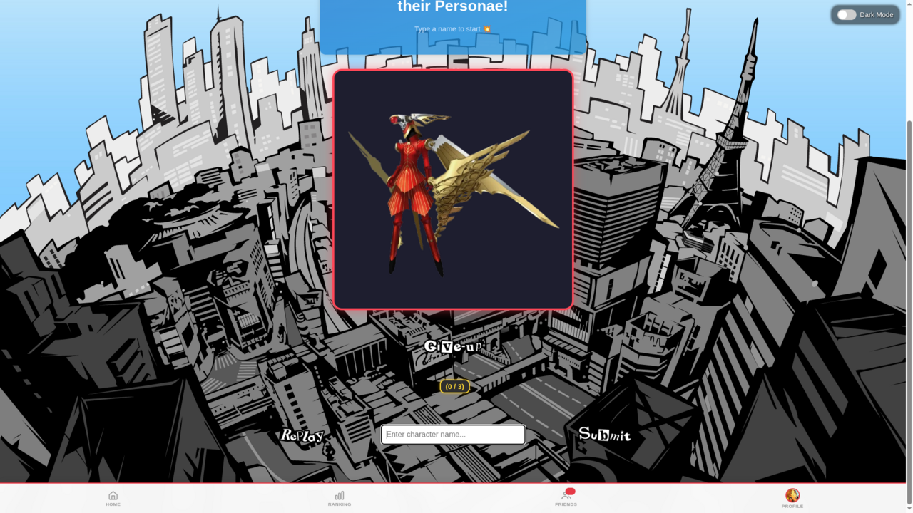<br><b>👤 Personae</b><br><sub>Here's the Persona — who wields it? From Orpheus to the Kanzato brothers.</sub></td>
    <td align="center">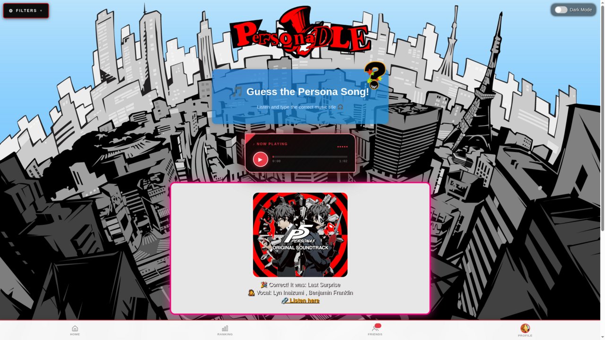<br><b>🎵 Music</b><br><sub>A few seconds of a track. 80+ songs, P1 → P5X, Q and Q2 included.</sub></td>
  </tr>
</table>

**⚡ Expert Mode** — every mode has a harder twin, earned by playing: a single quote instead of traits,
one _lying_ emoji, a flash you trigger yourself, a frozen black-and-white blur, lyrics without audio,
the Persona's real myth with its name masked. Expert keeps its own targets, stats and leaderboard.


## ✨ Features


<table>
  <tr>
    <td width="33%">🎖️ <b>69 badges</b><br><sub>Some secret, one you earn <i>together</i> with a friend, all verified server-side.</sub></td>
    <td width="33%">🏅 <b>Titles & Compendium</b><br><sub>Equip a title; every deed is written, dated, in your Compendium.</sub></td>
    <td width="33%">🖼️ <b>Profile card</b><br><sub>A shareable PNG of your profile — 8 themes, 39 wallpapers, copy straight to Discord.</sub></td>
  </tr>
  <tr>
    <td>👥 <b>Friends & Social Links</b><br><sub>Friend codes, P4 TV / calling-card animations, ranks 1 → 10 per Arcana.</sub></td>
    <td>⚔️ <b>Challenges</b><br><sub>Send your daily game to a friend — normal or Expert — and compare.</sub></td>
    <td>🏆 <b>Leaderboard</b><br><sub>By mode, period and dimension (Normal / Expert), friends-only scope.</sub></td>
  </tr>
  <tr>
    <td>☁️ <b>Cloud sync</b><br><sub>Offline-first; the server is the source of truth once you log in.</sub></td>
    <td>🎨 <b>Persona 5 UI</b><br><sub>Dark mode, colour-blind palette, profile music, atelier for everything you customise.</sub></td>
    <td>🛡️ <b>Admin & anti-cheat</b><br><sub>Moderation panel, event codes, daily target recomputed on the server.</sub></td>
  </tr>
</table>

<details>
<summary><b>More screenshots</b> — profile, leaderboard, friends</summary>
<br>
<table>
  <tr>
    <td>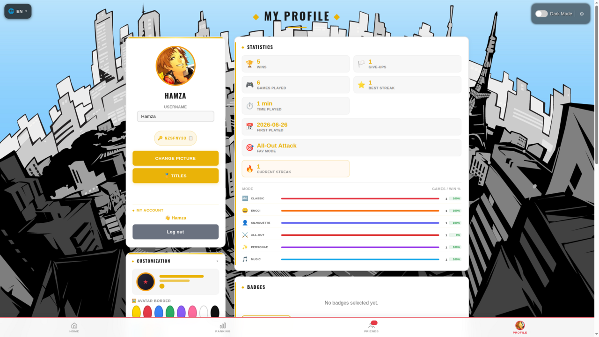</td>
    <td>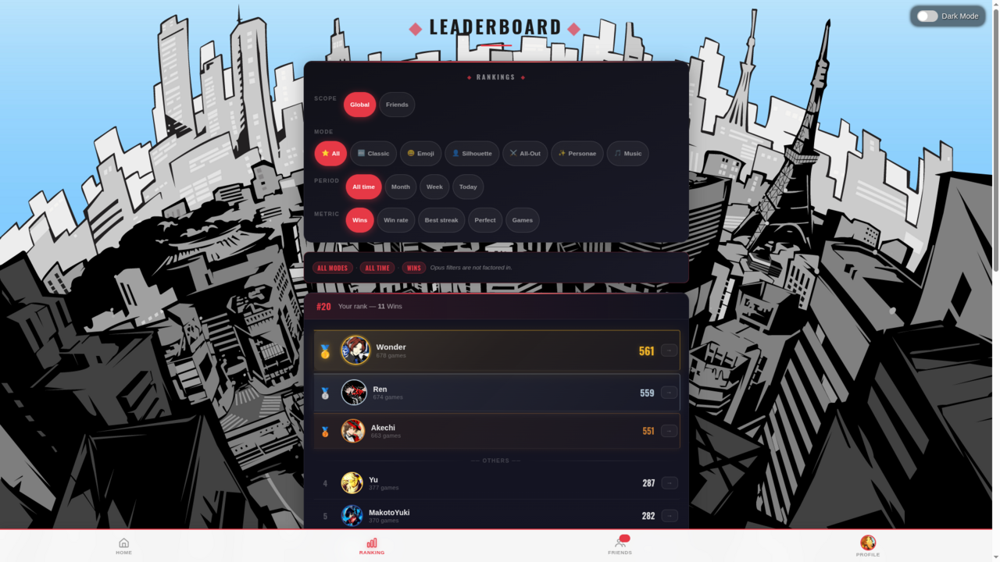</td>
  </tr>
  <tr>
    <td>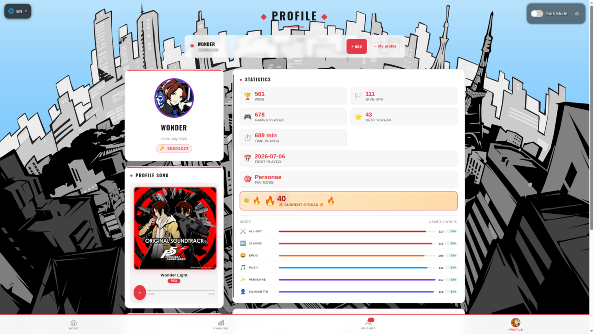</td>
    <td>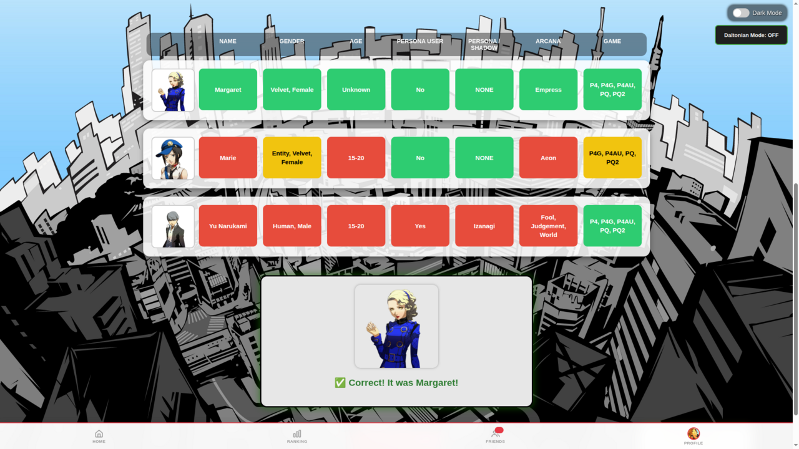</td>
  </tr>
</table>
</details>


## 🆕 What's new

**2.3 — September 2026** · _Kotone Shiomi_

- **Kotone Shiomi** joins All-Out Attack with her _Persona 5: The Phantom X_ animation, and her P5X portrait replaces the old one everywhere.
- **Friendship ranking**: a Social Link dimension that ranks bonds rather than players, with its own podium. Social Link XP no longer stops at rank 10.
- **Badges**: reorder your pinned ones by drag, click one to read its details, and an eye on every badge in the workshop. Five new badges and the _Déjà Vu_ title.
- **146 new profile pictures** (204 → 350), an _Animated_ tab, and _Sun_ from Persona 3 Portable in Music mode.
- **Lighter**: opening your profile went from 125.6 MB to 13.5 MB, and the heaviest All-Out Attack round from 80.2 MB to 3.2 MB.
- 2.3.1: badge and title unlocks are decided by the server, an Expert friend challenge no longer wins itself, Kotone's animated pictures stay animated, and the Classic page starts as high as the other modes on mobile.
- 2.3.2: on phones, Hint and Give Up sit side by side again in Classic — the answer field moved 170 px up — the duplicate "Delete my account" button left the profile page, and the empty notification dot left the Friends icon. On Discord, the daily is announced by 39 voices instead of 8 and the Sunday recap shows the podium's portraits.
- 2.3.3: the Replay button is back at the end of a Classic round — it had vanished in 2.3.2, in both normal and Expert, leaving no way to start over without reloading the page.
- 2.3.4: the Expert quest tooltip shows your current streak and your record (it looked stuck), a game restarted by a filter change in All-Out Attack is recorded again, each device keeps its own login instead of logging the others out, and the profile shows "First played" again with a statistics grid free of half-empty slots.

<details>
<summary>2.2 — Profile showcase &amp; Compendium</summary>

- **Profile showcase**: badges in large, wallpaper collection, share card; everything editable lives in one **Atelier**.
- **Compendium** of titles, **Expert leaderboard** dimension, opus filters in a window.
- **Wonder Shujin** in All-Out Attack, five new badges, the _Go Beyond_ title, seven titles, three songs.
- Persona Q / Q2 portraits, Persona 4 Revival wallpaper, Portuguese titles.
- 2.2.x: Expert stats editable, badge _Same Energy_ fixed, weekly Discord top 3, "Copy for Discord" repaired.

</details>

📦 **[All releases with notes →](https://github.com/CodeByHaamza/personadle/releases)** ·
📖 Player changelogs: [2.3](./PersonaDLE_Update_Documentation/PersonaDLE%202.3/PersonaDLE_Update.html) · [2.2](./PersonaDLE_Update_Documentation/PersonaDLE%202.2/PersonaDLE_Update.html) · [2.1](./PersonaDLE_Update_Documentation/PersonaDLE%202.1/PersonaDLE_Update.html) ·
🔧 Dev changelogs: [2.3](./PersonaDLE_Update_Documentation/PersonaDLE%202.3/DEV_CHANGELOG.md) · [2.2](./PersonaDLE_Update_Documentation/PersonaDLE%202.2/DEV_CHANGELOG.md) · [2.1](./PersonaDLE_Update_Documentation/PersonaDLE%202.1/DEV_CHANGELOG.md) · [2.0](./PersonaDLE_Update_Documentation/PersonaDLE%202.0/DEV_CHANGELOG.md)


## 🛠️ Under the hood

No framework, no bundler, no build step. The front end is plain ES modules; the back end is PHP with
prepared statements only; the database is the source of truth.

```
Browser ── ES modules ──► /api (PHP 8.2, PDO) ──► MariaDB 10.6+ → 31-table relational schema
   │                          │
   │  localStorage            │  sessions httpOnly · bcrypt · CSRF · rate limiting
   │  (offline-first)         │  CSP · HSTS · exact-origin CORS · Psalm taint analysis
   ▼                          ▼
Service worker              Cron: leaderboard cache, Discord daily & weekly posts, GDPR purge
```

| Layer         | What                                                                                              |
| ------------- | ------------------------------------------------------------------------------------------------- |
| **Front end** | HTML5 · CSS3 (one file per component, dark mode) · Vanilla JavaScript ES6+                        |
| **Back end**  | PHP 8.2 REST API — `GET/POST/PATCH/DELETE /api/{resource}`, JSON, proper status codes             |
| **Database**  | MariaDB 10.6+ / MySQL 8.0 — 31-table relational schema, 1719+ unit tests keep the contract honest |
| **i18n**      | EN · FR · ES · DE · IT · PT (1366 keys each), `en.json` is the source of truth                    |
| **Hosting**   | Hostinger, auto-deploy on push to `main`; SQL migrations applied by hand _before_ the merge       |

### Quality gates

Every pull request runs the whole thing; `main` only receives releases from `develop`.

```
Vitest + jsdom → 1719 tests unitaires (logique de jeu, backend, streak, i18n, validation données)
PHPUnit        → tests de logique pure + intégration DB (contrat de schéma)
Playwright     → 346 E2E sur la stack Docker complète (smoke, API, Social Link)
PHPStan        → analyse statique PHP niveau 5 · Psalm → taint analysis
ESLint+Prettier→ lint + format · i18n / data / daily-pool consistency checks
```

Supported browsers: Chrome 90+, Firefox 88+, Safari 14+ (iOS 14+), Edge 90+.


## 🧑‍💻 Run it locally

```bash
git clone https://github.com/CodeByHaamza/personadle.git && cd personadle
npm install

make up          # MariaDB + PHP + phpMyAdmin in Docker, schema and seed loaded → http://localhost:8080
npm test         # 1719 unit tests
make test-php    # PHPUnit, inside the container
npm run test:e2e # Playwright against the Docker stack
make check       # lint + data + i18n + doc numbers + daily pools
```

Where to read next: **[CONTRIBUTING.md](CONTRIBUTING.md)** (branches, conventions, review checklist) ·
**[DEPLOY.md](DEPLOY.md)** (release procedure, migrations) · **[ROADMAP.md](ROADMAP.md)** (what's next) ·
**[tests/README.md](tests/README.md)** and **[tests-e2e/README.md](tests-e2e/README.md)** (the test pyramid).


## 💬 Community


- **Discord — PersonaDLE** · [discord.gg/wpMdGGDp3y](https://discord.gg/wpMdGGDp3y): daily puzzle announcements, weekly top 3, the Velvet Room Arcana test, profile gallery, bug reports and ideas (one thread each — every thread gets a status).
- **Discord — Le Grimoire du Cœur** · [discord.gg/CfR8UHXTAE](https://discord.gg/CfR8UHXTAE): our French partner server, the most active.
- **Bugs & ideas** · [GitHub issues](https://github.com/CodeByHaamza/personadle/issues) work too.


## 👥 Credits

### Core team

<table>
  <tr>
    <td align="center">
      <br>
      <b>Hamza Karrouchi</b><br>
      <sub>Founder & lead developer — game design, logic, backend, UI, content, ops. Sole maintainer since mid-2025.</sub>
    </td>
  </tr>
</table>

### Contributors

PersonaDLE started as a small team in spring 2025. These people shaped its early days.

<table>
  <tr>
    <td align="center" width="33%">
      <br>
      <b>Léo (L2GENDAIRE)</b><br><sub>Data & design, 2025 — original character database, layout, portraits</sub>
    </td>
    <td align="center" width="33%">
      <br>
      <b>Damien (Corbover)</b><br><sub>Front end, 2026 — CSS modularisation, responsive groundwork</sub>
    </td>
    <td align="center" width="33%">
      <br>
      <b>Dzulian</b><br><sub>Consultant — Persona 1 & 2 ideas and data accuracy</sub>
    </td>
  </tr>
</table>

### Thanks

- **[Smashdle](https://smashdle.net/)** (Pimeko) for the concept, **[Pokedle](https://github.com/maxm33/pokedle)** for the early codebase reference.
- 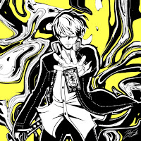 **[Arati](https://www.youtube.com/@Arati_Persona)** for featuring PersonaDLE, and  **[Faz](https://www.youtube.com/@FazPersona)** for the All-Out Attack footage.
- The **[Megami Tensei Wiki](https://megamitensei.fandom.com/)** for character data, r/persona4golden and both Discord servers for testing and endless feedback.
- **Atlus / SEGA** for the universe, **Shoji Meguro** for the music.


## ⚖️ License & disclaimer

The **source code** is released under the [MIT License](LICENSE.txt). The **game assets** — character
names, portraits, artwork, music, logos, quotes and any other Persona / Shin Megami Tensei content —
are **not** covered by it: they remain the property of their rights holders (© ATLUS · © SEGA) and may
not be redistributed. Reuse the code, bring your own assets.

PersonaDLE is a **fan-made, non-commercial project**, not affiliated with, endorsed by or connected to
Atlus or SEGA. Rights holders may request the removal of their material at any time; such requests are
honoured.

<sub>Some badges and wallpapers were made with AI assistance. As students working on this project for
free, we didn't have the budget to commission artists; we deeply respect them and would prioritise
working with human artists if PersonaDLE ever received support.</sub>


<p align="center">
  <strong>"I am thou, thou art I… And together, we'll reach the truth."</strong><br>
  <sub>Made with ❤️ by fans, for fans. If you enjoy PersonaDLE, support the official games.</sub>
</p>
